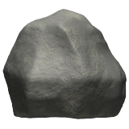
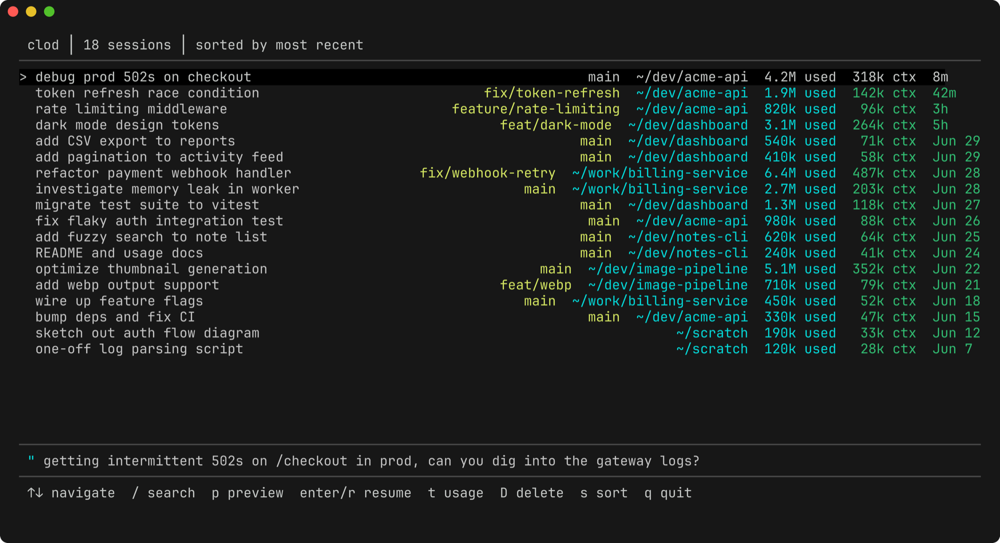
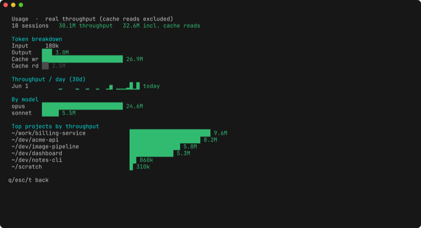

<div align="center">



# clod

Terminal UI for managing Claude Code and omp sessions.

[![npm][npm-image]][npm-url]
[![build][build-image]][build-url]

[npm-image]: https://img.shields.io/npm/v/@hype/clod.svg
[npm-url]: https://www.npmjs.com/package/@hype/clod
[build-image]: https://github.com/ungoldman/clod/actions/workflows/tests.yml/badge.svg
[build-url]: https://github.com/ungoldman/clod/actions/workflows/tests.yml

</div>

Browse, search, preview, resume, rename, and delete any session from any directory. Sessions from [Claude Code](https://github.com/anthropics/claude-code) and [omp](https://github.com/can1357/oh-my-pi) share one list.



Like `claude -r` but better.

## Install

**Requirements:**

- Node 22+
- Claude Code (`claude`) or omp (`omp`) on PATH to resume its sessions

Install globally via your node package manager of choice:

```
pnpm i -g @hype/clod
```

This puts `clod` on your PATH, so you can run it from anywhere:

```
clod
```

## Usage

`clod` takes no arguments. Running it launches the session browser. Two flags print and exit:

| Flag | Action |
|------|--------|
| `-h`, `--help` | Print usage |
| `-v`, `--version` | Print version |

### Keys

| Key | Action |
|-----|--------|
| `↑` / `↓` | Navigate list |
| `PgUp` / `PgDn` | Jump up/down a page |
| `/` | Search titles (fuzzy) and message contents |
| `space` | Preview conversation |
| `enter` | Resume selected session |
| `r` | Rename selected session (enter confirms, esc cancels; `←`/`→` move the cursor, `alt+←`/`→` jump by word) |
| `u` | Usage dashboard (token counts) |
| `s` | Cycle sort: recent → lexicographic → by directory |
| `h` | Cycle harness filter: all → Claude Code → omp |
| `D` | Delete (moves to Trash, see [What delete removes](#what-delete-removes)) |
| `q` / `esc` | Quit |

Rename and delete refuse a session that is open in a running Claude Code or omp, which would write its own title back or recreate the transcript. An omp left idle in a terminal counts as open too.

### What delete removes

Delete matches what each tool removes for its own sessions, and moves everything to Trash.

- **Claude Code:** the transcript and every file beside it named for the session, tasks, file-history, session-env, uploads, debug and telemetry files, the session's temp files, and its `history.jsonl` prompt lines.
- **omp:** the transcript, its artifact directory, any `.bak` copies, and the session's title and recap rows in `history.db`. Prompt history stays, as it does when omp deletes a session.

### What it shows

Each row: harness · session title · branch · project path · tokens used · context window · time since last activity

The first column marks the harness, `✻` for Claude Code and `π` for omp. It turns bright green while that tool has the session open.

Sessions you've named with `/rename` show that name in bold. Unnamed sessions show the title the tool generated, or the opening prompt in dim italic if there isn't one. omp's generated titles drop their leading Nerd Font icon so they sort with everything else.

omp doesn't record a git branch, so `clod` reads it from the repo's HEAD reflog as of the session's last activity. The branch is blank when the reflog can't answer, for example after a worktree is removed.

`used` is real throughput: tokens processed and generated (input + output +
cache writes), excluding cache reads. Cache reads re-count the same context
every turn and would inflate the figure ~10x, so they're left out. `ctx` is the
input context size of the session's most recent turn.

Times within today are relative (`now`, `5m`, `3h`); older sessions show a date.

Bottom bar: last user message from the selected session.

### Dashboard

Press `u` for an aggregate view across the sessions in the list, so `h` narrows it to one harness: total throughput, a token
breakdown by type (input / output / cache write / cache read), a 30-day
throughput-per-day sparkline, a per-model breakdown, and top projects by
throughput. The cache-inclusive grand total is shown alongside the headline so
you can see how much of the raw count is cache re-reads. All figures are real
recorded token counts, no estimation.



### How it works

Claude Code stores all session files in `~/.claude/projects/`, and omp stores its own in `~/.omp/agent/sessions/` (or under `$PI_CODING_AGENT_DIR` when set), regardless of which directory the session was started in. `clod` reads from there directly. No home directory scanning.

### Maintenance

`scripts/cleanup.js` trashes orphaned Claude Code session artifacts under `~/.claude`
(file-history, session-env, tasks, telemetry, and stale `history.jsonl` lines
for sessions with no transcript left). Dry-run by default; `--apply` to act.
Per-session delete already covers these, so this is only for backlog from
deletions made outside `clod`. Don't `--apply` mid-session — a just-started
session looks orphaned until its transcript flushes.

```
node scripts/cleanup.js          # preview
node scripts/cleanup.js --apply  # trash them
```

## Development

TypeScript, ESM-only. Source in `src/` compiles to `dist/` with `tsc`.

```
pnpm dev        # run from source with reload
pnpm test       # lint, typecheck, build, and run tests
pnpm coverage   # tests with the 100% coverage gate
pnpm lint       # biome check
pnpm format     # biome check --write
```

Tests use `node:test` and run through Node's type stripping, so no test-runner
dependency. Every module in `src/` is held at 100% coverage except `src/index.ts`,
`src/trash.ts`, and `src/proc.ts`, and the Ink render layer (`src/ui.ts`) is driven through
`ink-testing-library`.

## Contributing

Contributions are welcome. See [CONTRIBUTING.md](CONTRIBUTING.md) for guidelines.

## License

[ISC](LICENSE)

Logo is the rock emoji, rendered locally from the system Apple Color Emoji font.
